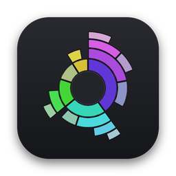

<p align="center">
  
</p>

# Broom

A fast disk space analyzer for macOS, in the spirit of DaisyDisk. Scan a disk or folder, explore it
as an interactive sunburst, collect what you don't need, and delete it in one go.

## Requirements

- macOS 27.2 or later
- Xcode 27 or later

## Getting started

1. Open `Broom.xcodeproj` in Xcode.
2. If you're not on the project's development team, pick your own team under **Signing &
   Capabilities** for the Broom target.
3. Pick a scheme (see [Builds](#builds)) and press ⌘R. Broom opens with a short onboarding that
   walks you through turning on Full Disk Access, then shows your disks.

## Features

- **Onboarding at launch** that walks you through Full Disk Access and ticks itself off as soon as
  it's on.
- **Disks screen** listing mounted volumes with capacity bars. Scan a volume, choose a folder, or
  drop a folder on the window.
- **Fast scanning** with `getattrlistbulk` on a pool of worker threads, with a live ring that fills in
  as top-level folders are counted.
- **Sunburst map**: wedges sized by disk usage, colored by position, up to six levels deep. Biggest
  items get the cool colors, and there's no red, which is kept for deleting. Items too thin to see
  are merged into a grey "smaller items" wedge. Zooming in and out is animated.
- **Side list** of the current folder's contents, kept in sync with the map (hover, selection, colors).
- **Collector**: drag items from the map or list into the tray at the bottom. Then move them all to
  the Trash, or delete them immediately.
- Quick Look, Reveal in Finder, Copy Path, back/forward history, clickable path bar.
- A banner when folders couldn't be read, with a shortcut to Full Disk Access settings.

## Navigation

| Action | Mouse | Keyboard |
| --- | --- | --- |
| Zoom into a folder | Click its wedge or row | → or Return (selected row), ⌘↓ |
| Go up one level | Click the center circle | ← or ⌫, ⌘↑ |
| Jump to any parent | Click it in the path bar | ⌘⇧↑ goes to the top |
| Back / forward | Toolbar arrows | ⌘[ / ⌘] |
| Select items | Click a file | ↑ / ↓ |
| Quick Look | Context menu | Space, ⌘Y |
| Collect for deletion | Drag to the tray | ⌘⌫ |
| Delete collected items | Delete button | ⌘⇧⌫ |
| Rescan / scan folder | Toolbar | ⌘R / ⌘O |

## Testing

In Xcode, press ⌘U. From the command line:

```bash
xcodebuild test -project Broom.xcodeproj -scheme Broom -destination 'platform=macOS'
```

`BroomTests` covers the scanner (on real temporary folders), the chart layout and geometry,
navigation, the collector and tree edits.

To check the scanner and models without a Mac (for example in CI), `LinuxHarness/run.sh` builds them
on Linux in Swift 5 and strict Swift 6 modes, runs the same tests, and stress-tests the scanner under
ThreadSanitizer. See [LinuxHarness/README.md](LinuxHarness/README.md).

## How the scanner works

`Broom/Scanning/DiskScanner.swift`

- **One system call per batch of entries.** `getattrlistbulk` returns names, types, allocated sizes,
  link counts and mount status for hundreds of entries at once, so files never need a separate
  `stat`.
- **Dedicated threads, not the main thread or Swift's cooperative pool.** About two threads per CPU
  core (4 to 24) share a LIFO work queue guarded by an `NSCondition`. Each worker keeps one subfolder
  for itself and shares the rest, so most folders never touch the shared queue.
- **Totals are added up during the scan.** Each folder counts the subfolders it's waiting on, using
  an atomic with acquire/release ordering. The worker that finishes the last one sums and sorts the
  parent, then carries on upward. The tree is ready the moment the last worker goes idle, with no
  second pass.
- **Correct disk usage:** sizes are allocated bytes, and hard-linked files are counted once. Other
  volumes, mount points and automount triggers are skipped. Scanning `/` follows the firmlinks into
  the Data volume but skips `/System/Volumes/Data`, so nothing is counted twice.

### Threading rules

The project uses `SWIFT_DEFAULT_ACTOR_ISOLATION = MainActor`, so everything is on the main actor
unless marked otherwise.

- The scanning types (`FileNode`, `DiskScanner`, `ScanProgress`, `BulkDirectoryReader`) are
  explicitly `nonisolated`.
- While scanning, a node is written only by the worker that owns it. The UI only reads atomic
  counters (`ScanProgress`), polled about 20 times a second.
- When the scan ends, the tree is handed to the main actor through a continuation. After that it is
  only read or edited on the main actor (`FileNode.removeChild` is `@MainActor`).
- Blocking work (listing volumes, trashing or deleting files) runs in `@concurrent` functions, off
  the main actor. An old tree is freed by a background task, so dropping millions of nodes doesn't
  stall the UI.

## Builds

There are two ways to build Broom. Each has its own scheme, configurations and xcconfig file:

| Scheme | Configurations | Settings | App Sandbox |
| --- | --- | --- | --- |
| Broom | Debug, Release | `Configurations/Sandboxed.xcconfig` | On, as the Mac App Store requires |
| Broom (No Sandbox) | Debug-NoSandbox, Release-NoSandbox | `Configurations/NoSandbox.xcconfig` | Off, for direct download (signed and notarized), like DaisyDisk's |

The code works in both: it checks at runtime whether it's sandboxed.

```bash
xcodebuild build -project Broom.xcodeproj -scheme "Broom (No Sandbox)" -destination 'platform=macOS'
```

## Permissions

- **Full Disk Access.** macOS protects some folders (Mail, Messages, Safari, other apps' data), and
  apps can't ask for access with a prompt. At launch, Broom shows an onboarding screen that opens
  **System Settings › Privacy & Security › Full Disk Access** and checks every second until Broom is
  switched on. You can skip it, and reopen it anytime from **Broom › Full Disk Access…**.
- **Sandboxed build only.** Broom can read only what you pick in an open panel. Onboarding starts by
  asking for your startup disk; that access lasts until Broom quits. Scanning another disk asks for
  that disk. Deleting needs read-write access (`ENABLE_USER_SELECTED_FILES = readwrite`).
- **No Sandbox build.** Broom scans disks directly, with no panel.

## Project layout

```
Broom/
  BroomApp.swift              App, window and menu commands
  ContentView.swift           Switches between the three screens
  Scanning/                   Scanner engine (nonisolated, thread-safe)
  Models/                     AppModel (screens, scans), BrowserModel (navigation, collector)
  Sunburst/                   Layout math, geometry, transitions, and the chart view
  Views/                      Home, scanning, results, list, top bar, collector, theme
BroomTests/                   Scanner, layout and navigation tests (Swift Testing)
BroomUITests/                 UI test template
Configurations/               Sandboxed and NoSandbox xcconfig files
LinuxHarness/                 Builds and tests the scanner and models on Linux
CLAUDE.md                     Notes for working on the code with Claude Code
```

## Working on the code

[CLAUDE.md](CLAUDE.md) lists the project's conventions and the rules that keep the scanner
thread-safe. It's written for Claude Code, but it's a quick read for anyone changing the code.
